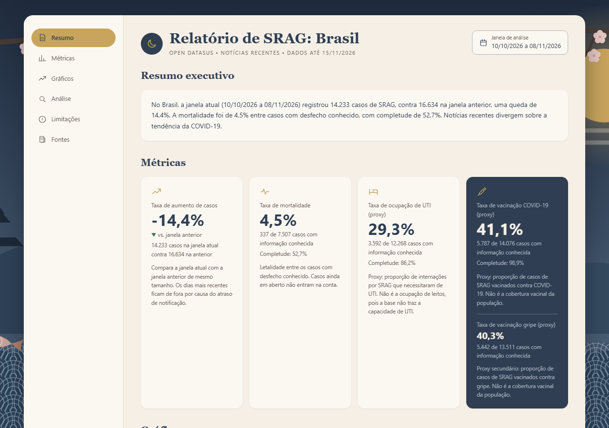
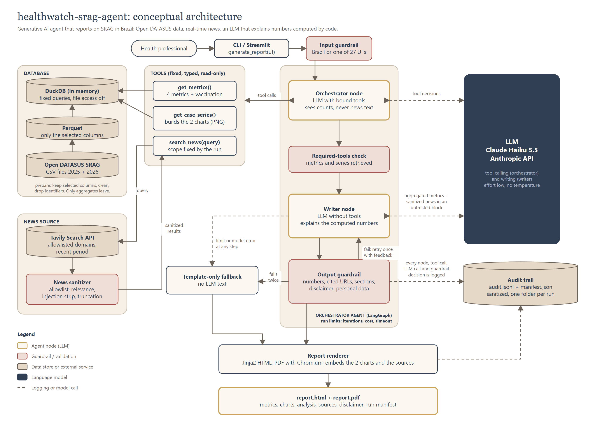

# healthwatch-srag-agent

Agentic AI that generates automated SRAG (Severe Acute Respiratory Syndrome) outbreak reports from Brazil's Open DATASUS data, combining key metrics, charts and real-time news context. Built with LangGraph, with audit logging and guardrails.

> Proof of Concept for Indicium HealthCare Inc. The report is informational and **does not replace medical or public-health guidance**.



A real report is in [`docs/sample_report/`](docs/sample_report/): [HTML](docs/sample_report/report.html), [PDF](docs/sample_report/report.pdf), [audit trail](docs/sample_report/audit.jsonl) and [manifest](docs/sample_report/manifest.json).

## Contents

1. [Overview](#overview)
2. [Architecture](#architecture)
3. [Metrics](#metrics)
4. [Quickstart](#quickstart)
5. [Usage](#usage)
6. [Governance and transparency](#governance-and-transparency)
7. [Guardrails](#guardrails)
8. [Sensitive data handling](#sensitive-data-handling)
9. [Project structure](#project-structure)
10. [Testing and code quality](#testing-and-code-quality)
11. [Limitations and future work](#limitations-and-future-work)
12. [Decisions](#decisions)
13. [AI use and review](#ai-use-and-review)

## Overview

Given a scope (all of Brazil or one state), the agent:

1. Computes four metrics from the Open DATASUS SRAG dataset: case growth rate, mortality rate, ICU admission proportion (ICU occupancy proxy) and vaccination proportion among cases (vaccination proxy).
2. Builds two charts: daily cases (last 30 days) and monthly cases (last 12 months).
3. Searches recent SRAG news from trusted sources.
4. Uses an LLM to explain the scenario, grounded only on the computed metrics and the retrieved news, with citations.
5. Produces `report.html` and `report.pdf`, plus a full audit trail of the run.

## Architecture



- Conceptual diagram: [`docs/architecture.pdf`](docs/architecture.pdf) (source: [`docs/architecture.svg`](docs/architecture.svg))

Flow of one run (`generate_report(uf)`, used by both the CLI and Streamlit):

| Step | Component | What it does |
|---|---|---|
| 1 | Input guardrail | Accepts only Brazil or one of the 27 UFs |
| 2 | Orchestrator node (LLM + tools) | The model decides which tools to call. It sees only counts, never news text |
| 3 | Tools | `get_metrics` (DuckDB), `get_case_series` (builds the 2 charts), `search_news` (Tavily + sanitizer). Fixed, typed, read-only |
| 4 | Required-tools check | The report cannot be written without metrics and case series |
| 5 | Writer node (LLM, no tools) | Explains the computed numbers and cites the news, which arrive in an "untrusted content" block |
| 6 | Output guardrail | Checks numbers, cited URLs, sections, disclaimer and personal data. One retry with feedback |
| 7 | Fallback | If the text fails twice, or a limit or model error stops the run, a template-only report is produced (no LLM text) |
| 8 | Report renderer | Jinja2 HTML and PDF (Chromium), with charts, sources, disclaimer and run manifest |

Every step is written to the audit trail. The LLM never calculates numbers: deterministic Python computes them and the model only explains them.

## Metrics

Formulas, windows and limitations: [`docs/METRICS.md`](docs/METRICS.md).

| Metric | Definition (short) |
|---|---|
| Case growth rate | Cases in the last 30 days vs the previous 30 days (excluding the reporting-lag days) |
| Mortality rate | SRAG deaths / cases with a closed outcome |
| ICU occupancy (proxy) | Share of SRAG cases admitted to ICU (the dataset has no bed capacity) |
| Vaccination (proxy) | Share of SRAG cases vaccinated (the dataset has no population denominator) |

## Quickstart

Requirements: Python 3.12 (installed by uv), [uv](https://docs.astral.sh/uv/), an Anthropic API key and a Tavily API key.

```bash
git clone https://github.com/barbaraalvx/healthwatch-srag-agent.git
cd healthwatch-srag-agent
uv sync
uv run playwright install chromium
cp .env.example .env        # Windows PowerShell: Copy-Item .env.example .env
# edit .env and fill ANTHROPIC_API_KEY and TAVILY_API_KEY
```

Data: from the [Open DATASUS SRAG 2019 to 2026 dataset](https://dadosabertos.saude.gov.br/dataset/srag-2019-a-2026), download the CSV files the sample report used, one per year: [2025 (`INFLUD25`)](https://dadosabertos.saude.gov.br/dataset/srag-2019-a-2026/resource/20c49de3-ddc3-4b76-a942-1518eaae9c91) and [2026 (`INFLUD26`)](https://dadosabertos.saude.gov.br/dataset/srag-2019-a-2026/resource/74091efc-3f75-42e8-a6fa-6b79a8d30582). Put them in `data/raw/`, then:

```bash
uv run python -m srag.data.prepare
```

## Usage

```bash
uv run python -m srag              # Brazil
uv run python -m srag --uf SP      # one state
uv run streamlit run src/srag/ui/streamlit_app.py
```

Outputs are written to `reports/<timestamp>_<run_id>/`. A sample is in [`docs/sample_report/`](docs/sample_report/).

## Governance and transparency

Each run gets a `run_id` (UUID4) and its own folder, `reports/<timestamp>_<run_id>/`, with:

- `audit.jsonl`: one JSON object per event (`node_start`, `node_end`, `tool_call`, `llm_call`, `guardrail`, `error`) with sanitized inputs, an output summary, model, prompt version, tokens, cost and duration.
- `manifest.json`: model, effort, prompt versions, SHA-256 of the data file, data reference date, git commit, final status and totals (events, tokens, cost).
- The report footer repeats the `run_id`, generation time, data date and model.
- The Streamlit app shows the audit table of the run in an expander.

Example line from [`docs/sample_report/audit.jsonl`](docs/sample_report/audit.jsonl) (real run, about US$ 0.0015 in total):

```json
{"run_id": "dacbe50f-...", "event_type": "llm_call", "node": "orchestrator", "output_summary": {"tool_calls": ["get_metrics", "get_case_series", "search_news"]}, "model": "claude-haiku-5-5", "prompt_version": "orchestrator_v1", "tokens_in": 1120, "tokens_out": 108, "cost_usd": 0.000166, "duration_ms": 1983}
```

Inspect a run with `cat reports/<folder>/audit.jsonl` (PowerShell: `Get-Content`). Only aggregates and truncated text are logged, never row-level data or secrets.

## Guardrails

| Layer | Rule | On failure |
|---|---|---|
| Input | `uf` must be empty (Brazil) or one of the 27 UFs | Rejected before the agent starts |
| Tools | Fixed, typed and read-only. No free SQL, shell or code. DuckDB runs in memory with file access off and locked settings | Not applicable: the model cannot ask for anything else |
| News | Domain allowlist, relevance filter, injection-like text stripped, truncation. News goes to the writer inside an "untrusted content" block and the prompt says never to obey it | Item dropped. With no trustworthy news, the report says so |
| Agent limits | Max iterations, max tokens per call, timeout and max cost per run | Run stops with an audited reason and the template-only report is produced |
| Required tools | Metrics and case series must have been retrieved | The model does not write the report |
| Output | Numbers match computed values (tolerance 0.1), cited URLs come from the retrieved news, required sections, medical disclaimer, no personal-data patterns | One retry with feedback, then the template-only report. The failure is audited |

## Sensitive data handling

- **Data minimization (LGPD):** only 9 of the 194 raw columns are kept (case date, UF, age band, ICU, outcome, COVID and flu vaccination, final classification). Names, birth date, address, municipality and health-unit codes, free text and every column no metric needs are dropped at ingestion. Exact age becomes an age band. Details: [`docs/DATA.md`](docs/DATA.md).
- **Aggregates only:** nothing row-level reaches the LLM, the logs, the reports or the UI. Rates computed on fewer than 30 records are flagged as unstable.
- **Secrets:** only in `.env` (git-ignored); keys are masked in logs and never appear in the audit trail. `data/` and `reports/` are git-ignored.
- **Output check:** the generated text is scanned for personal-data patterns.

## Project structure

```
src/srag/
  __main__.py      CLI          service.py   generate_report(uf)
  config.py        settings     formatting.py, text.py
  data/            schema, cleaning, prepare (CSV -> Parquet), repository (DuckDB)
  metrics/         pure metric functions and snapshot
  charts/          series and matplotlib charts
  news/            Tavily client, relevance, sanitizer, untrusted block
  agent/           LangGraph graph, nodes, tools, prompts (versioned), fallback
  guardrails/      input, output and run limits
  audit/           JSONL logger, sanitizer and manifest
  report/          Jinja2 template, renderer, PDF
  ui/              Streamlit app and audit view
tests/             mirrors src/srag, with synthetic data and fake LLM/news
docs/              architecture, DATA, METRICS, DECISIONS, sample_report/
scripts/           export_architecture.py
```

## Testing and code quality

```bash
uv run pytest
uv run ruff check .
uv run ruff format --check .
```

Tests use synthetic fixtures and fake LLM/news clients, so they run without the dataset or API keys. CI runs on every push.

## Limitations and future work

- ICU and vaccination metrics are proxies (see [`docs/METRICS.md`](docs/METRICS.md)).
- The public dataset is published with a delay; the report states its reference date.
- The latest weeks of the public data are incomplete because of notification lag, so the last days are left out of the growth rate.
- The mortality rate uses only cases with a closed outcome; in the sample report that is 52.7% of cases, and the report shows this completeness.
- Each run covers one scope (Brazil or one state); there is no free-form question mode, by design.
- News coverage depends on Tavily and on the allowlisted domains. Some pages have no date and are accepted with that noted.
- The model (Haiku, low effort) is cheap and fast, but its wording can vary between runs. The numbers do not, because code computes them.
- Cost: each run is about US$ 0.0015 to 0.0025 plus 1 to 2 Tavily credits.
- Future work: per-state comparison, a population denominator for real vaccination and ICU-occupancy rates (needs another data source) and scheduled runs.

## Decisions

All architecture and design decisions are recorded in [`docs/DECISIONS.md`](docs/DECISIONS.md).

## AI use and review

This project was developed with the help of an AI coding assistant (Claude Code, by Anthropic). The implementation plan ([`docs/PLANO_DE_IMPLEMENTACAO.md`](docs/PLANO_DE_IMPLEMENTACAO.md)) came from my own guidelines plus a feasibility analysis made with Claude. I reviewed the plan and all the code in this repository. [`CLAUDE.md`](CLAUDE.md) holds the instructions given to the assistant. Inside the product, the LLM only explains numbers that deterministic code computes.
